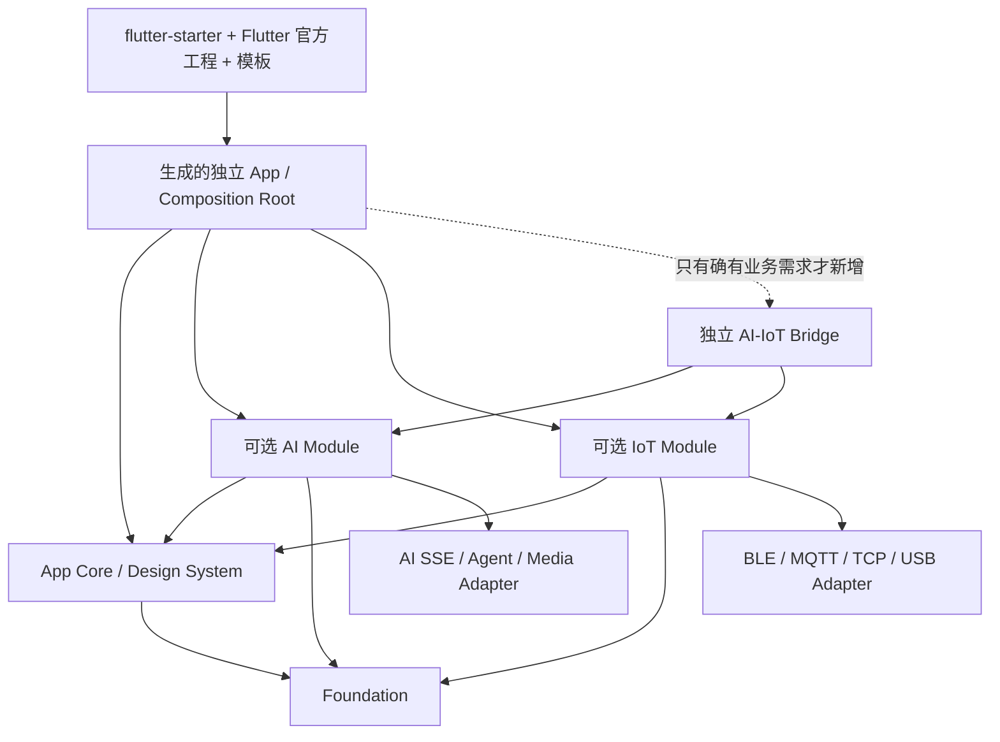

# Flutter Enterprise Starter V2.0

> **单仓库 · 多产品模板 · 独立 AI / IoT 模块 · 可复用 Packages · 自动化创建新 App**  
> **正式架构设计、开源项目借鉴分析与落地实施规范**  
> 版本：`2.0.0-design` ｜ 编制日期：2026-11-02 ｜ 状态：**V1 已有初版代码，待端到端验收。V2 为演进设计。**
>
> 适用对象：Flutter 独立开发者、技术负责人、AI 编程工具、后续产品工程团队  
> 服务端边界：以 FastAPI 提供 HTTP/SSE/API 契约为主，不展开后端内部架构。

---

## 0. 执行摘要与必须遵守的决策

### 0.1 目标

只长期维护**一个 Starter Git 仓库**。未来创建工具 App、AI App、IoT App、内容 App、电商 App 或 AI+IoT 组合 App 时，能够：

1. 拉取 Starter 仓库；
2. 选择模板和目标平台。V1 提供 `base`、`content`、`shop`、`character`、`course`，后续扩展 `ai`、`iot`、`combined`；
3. 填入应用名称、组织标识、Bundle ID、品牌主题、API 地址；
4. 生成**拥有自己 Git 历史、可独立运行和独立发布**的新 Flutter 项目；
5. 开始开发该项目特有的 `features/`，不重复搭建认证、路由、网络、日志、UI、测试；
6. 后续自行选择是否升级公共模块，而不是被 Starter 的变更强制影响。

所有产品通过稳定的基座 API 复用通用能力。模板定义起步组合，生成后的产品可独立新增、替换或移除业务 Feature。

### V1 的实施范围

当前代码包含 `flutter-starter list`、`flutter-starter create`、五个 V1 模板，以及 `starter_network`、`starter_storage`、`starter_sync`、可选 `starter_realtime`、`starter_database`、`starter_config` 和 `starter_auth` 公共包。生成器调用 Flutter 官方命令生成平台工程，将所需基座源码复制到各产品，并用相对路径引用。首个验收平台为 Web，实施顺序见第 16 节。

### 0.2 不可妥协的 12 条架构决策

| ID | 约束 | 说明 |
|---|---|---|
| ADR-001 | 单一 Starter Git 仓库 | 管理模板、独立包、生成器、示例、文档和 CI |
| ADR-002 | 生成的新产品默认 Standalone | 自带所需共享源码，脱离 Starter 原目录即可构建 |
| ADR-003 | AI 与 IoT 完全平行 | 不得互相 import、互相调用内部 Repository、互相安装对方专属 SDK |
| ADR-004 | Base 不依赖 AI、IoT | 纯工具类 App 不引入专业模块 |
| ADR-005 | 按业务 Feature-First | 模块内部再按 Presentation / Domain / Data 分层 |
| ADR-006 | MVVM + Repository | Presentation 不直接碰 HTTP、SQLite、BLE、MQTT |
| ADR-007 | Domain 层按复杂度启用 | 不强迫每个简单查询都生成 UseCase |
| ADR-008 | Riverpod 作为统一状态与 DI 方案 | 单一数据源、可替换 Repository、控制 Provider 生命周期 |
| ADR-009 | 传输、协议、业务状态分离 | SSE / JSON / AG-UI、BLE / MQTT / TCP 分别设置适配边界 |
| ADR-010 | 模块以编译期组装为主 | 不预设复杂反射式动态插件平台 |
| ADR-011 | 每个生成模板都能真实构建 | 代码生成后要通过格式、分析、测试和目标平台构建 |
| ADR-012 | 借鉴思路不等于复制源码 | 每个参考仓库需要检查许可证和第三方资源授权 |

### 0.3 非目标（避免过度工程化）

- **不**建设在线的模板市场、远程热更新任意 Dart 代码、可视化低代码平台；
- **不**强制所有产品接入 FastAPI 或统一云服务；
- **不**强制每个 Feature 有 15 个接口和 20 个文件；
- **不**在 Core 中放聊天、设备协议或业务支付规则；
- **不**把 AI 与 IoT 合并为一个 `ai_iot_core`；
- **不**承诺任意平台 BLE、USB、后台任务具有相同行为；
- **不**将实验性 SDK API 直接暴露为 Starter 稳定公共 API。

### 0.4 术语

- **Starter Repo**：维护模板与共享能力的“母仓库”。
- **Generated App**：通过 CLI 创建、独立维护的产品仓库。
- **Template**：应用入口、默认页面、依赖与路由组合的起步配置。平台工程由 `flutter create` 生成，模板可按所选能力补充原生配置。
- **Package**：有明确公共 API 和可复用逻辑的 Dart/Flutter 包。
- **Feature**：具体产品的业务边界，如聊天、商品列表、设备面板。
- **Composition Root**：生成的 App 中集中装配依赖和路由的地方。
- **Standalone 模式**：将所需 Package 复制入新工程，引用本地 path。
- **Shared 模式**：新工程引用版本化 Git/私有 Hosted Package，不复制底层实现。

---

## 1. 开源参考项目研究方法与取舍准则

这套架构不是将某一个热门仓库全量 Fork，而是对不同质量维度进行**有证据的专项借鉴**。需要分开考虑：

| 评价维度 | 关键检查 | 在 Starter 中体现 |
|---|---|---|
| 边界清晰 | UI 是否直接调用 SDK？数据层是否泄漏 DTO？ | 固定模块 API 与依赖方向 |
| 真实业务复杂度 | 是否处理多任务、断线、离线、多用户、多设备？ | AI Run、Device Session、缓存同步 |
| 扩展成本 | 新服务商、新硬件、新页面要修改多少文件？ | Adapter / Codec / Feature Generator |
| 可测试性 | 无网络/硬件能否稳定测试？ | Fake Service、SSE Fixture、协议帧 Fixture |
| 研发体验 | 创建、构建、格式、分析、发布是否标准化？ | CLI、Mason、Melos、AGENTS.md |
| 兼容与安全 | 是否支持目标平台？依赖许可证是否允许商业用途？ | 平台矩阵与 License Audit |
| 对新产品的适用度 | 是产品实现还是通用工程？ | 仅提取通用能力，不复制高度耦合代码 |

**证据分级：** A = 官方文档/仓库 README 或工程文件明确确认；B = 可从工程目录/依赖合理归纳；C = 为本 Starter 提出的设计建议、并非原仓库事实。正式参考仓库应固定 Tag/Commit 后审读关键文件；下列检查路径是代码阅读入口，不保证各仓库所有路径永远不变。

---

## 2. 开源项目深度借鉴矩阵

### 2.1 一览表：哪个项目提供哪部分启发

| 优先级 | 项目 / 仓库 | 定位 | 明确借鉴 | 不照搬 / 注意 |
|---|---|---|---|---|
| S | [Flutter 官方架构 + Compass](https://docs.flutter.dev/app-architecture/guide) · [源码](https://github.com/flutter/samples/tree/main/compass_app) | MVVM 架构范本 | View / ViewModel / Repository / Service、UDF、DI、Fake Tests | 不强制使用原示例的 ChangeNotifier |
| S | [Very Good CLI](https://github.com/VeryGoodOpenSource/very_good_cli) / [Templates](https://github.com/VeryGoodOpenSource/very_good_templates) | 工程生成与质量体系 | CLI 子命令、Mason Brick、生成 Hook、覆盖率、CI | 不直接引入全部 BLoC 模板 |
| S | [Immich](https://github.com/immich-app/immich) | 大型照片 App | Riverpod、本地实体、OpenAPI DTO 隔离、同步、后台任务 | 大型业务耦合；AGPL 代码不能简单移植到闭源工程 |
| S | [Lichess Mobile](https://github.com/lichess-org/mobile) | 实时互动应用 | Riverpod/Freezed、实时消息、严格分析、AGENTS 与测试 | 棋类状态机专属；GPL 许可证 |
| S | [Flutter AI Toolkit](https://github.com/flutter/ai) | AI Chat UI 组件 | LLM Provider 接口、流式气泡、附件、序列化 | UI Toolkit 不是 Agent 后端 |
| S | [AG-UI Dart](https://github.com/ag-ui-protocol/ag-ui/tree/main/sdks/community/dart) | Agent 交互协议 SDK | 类型事件、SSE、工具生命周期、JSON Patch、状态快照 | SDK 的取消行为与 HTTP 连接释放需单独验证 |
| A | [Flutter GenUI](https://github.com/flutter/genui) | 动态生成 UI | 受控组件 Catalog、A2UI、表单交互、数据绑定 | 快速演进，需隔离版本 / API |
| S | [ThingsBoard Mobile](https://github.com/thingsboard/flutter_thingsboard_app) | IoT 管理 App | 设备管理、仪表盘、告警、SDK 边界、白标化 | 不绑定 ThingsBoard 平台 |
| S | [MeshCore Open](https://github.com/zjs81/meshcore-open) | LoRa 设备客户端 | BLE/USB/TCP、帧解析、离线消息、重试、平台差异 | 原仓库用 Provider/ChangeNotifier，不强求照搬 |
| A | [Mobileraker](https://github.com/Clon1998/mobileraker) | Klipper 打印机 App | 设备指令确认、实时状态、摄像头、危险命令边界 | **非商业限制许可证**；仅学习方案 |
| A | [LocalSend](https://github.com/localsend/localsend) | 跨端传输 | Flutter/Rust 分层、Isolate、设备通信、原生能力适配 | 当前采用 Refena，不是 Riverpod |
| A | [AppFlowy](https://github.com/AppFlowy-IO/AppFlowy) | 协作文档/编辑器 | 复杂工作台、编辑器、插件分层、多端 | 体量大，主仓库 AGPL |
| A | [Ente](https://github.com/ente-io/ente) | 加密相册与多产品 Monorepo | 离线优先、后台上传、密钥/同步、独立产品共享能力 | 密码学不要自行模仿实现 |
| A | [Wonderous](https://github.com/gskinnerTeam/flutter-wonderous-app) | 高保真 UI | 动画、品牌化 Design System、沉浸式转场 | 演示体验优先，不是业务底座 |
| A | [OpenChat](https://github.com/mhingston/openchat) | Flutter 多模型聊天 | 多模型配置、流式 Markdown、历史会话、快捷交互 | 客户端直连模型与本方案后端代理不同 |
| A | [PocketLLM](https://github.com/PocketLLM/PocketLLM) | Flutter + FastAPI AI 助手 | 前端薄客户端、Provider 管理、模型列表、流式 UI | 其认证和数据方案不是 Starter 的强制选项 |
| B | [flutter-pi](https://github.com/ardera/flutter-pi) / [flutter-elinux](https://github.com/sony/flutter-elinux) | 嵌入式 Linux 设备屏 | Framebuffer/DRM、插件适配、HMI 部署 | 不是手机 BLE App 的默认运行时 |

### 2.2 Flutter Compass：学习“职责边界”，而不是复制状态库

**定位**：Flutter 官方以旅行规划 App 解释 UI/Data 分层、MVVM、Repository、Service、按需 Domain。源码仓库包含完整案例，官方指南有对应设计说明。

**核心拆解**：

- **View** 负责渲染和用户事件入口；**ViewModel** 转换领域数据为 UI State，并暴露命令；
- **Repository** 提供单一数据源，封装 API、缓存、刷新、错误恢复；
- **Service** 只负责外部输入/输出，原则上不承担业务状态；
- **Domain UseCase** 适用于合并多个 Repository 或具有复杂的业务规则；
- 推荐单向数据流：`View -> Command -> ViewModel -> Repository -> Service`，数据沿反向返回。

**落地到 Starter**：

- `features/*/presentation/` 使用 `Page + ViewModel + UI State`；
- `features/*/domain/repositories/` 定义稳定契约；
- `features/*/data/` 封装 DTO/Mapper/数据源；
- CLI 自动生成轻量/完整两个 Feature 版本；
- 新 UI 页面不直接调用 `Dio`、`Drift`、`flutter_blue_plus`。

**不要照搬**：原示例状态库选择不是不可替换的架构条件；Starter 使用 Riverpod。**参考事实**见 [官方推荐](https://docs.flutter.dev/app-architecture/recommendations)、[架构指南](https://docs.flutter.dev/app-architecture/guide)。

### 2.3 Very Good CLI / Templates：学习“生成器也是产品”

**定位**：不是业务 App，而是 CLI + 模板 + 测试 + 自动发布机制。核心仓库提供 `create`、`test` 等子命令，模板通过 Mason 生成，CLI 会进行生成后处理。

**值得深读的路径**：

- CLI 的 `lib/src/commands/`、`lib/src/cli/`、`test/`、`e2e/`；
- 模板仓库里的 `mason.yaml`、对应 Brick 的 `brick.yaml`、`__brick__/`、`hooks/`；
- `AGENTS.md`、`analysis_options.yaml`、GitHub Actions。

**核心设计借鉴**：

1. 命令按子命令职责拆分，`create`、`make`、`doctor`、`upgrade` 不应写进单个大函数；
2. 用 Mason 模板引擎完成文件生成，生成前校验变量，生成后调用配置及检查；
3. Process Runner、Logger、Filesystem、模板解析接口可被注入替代，便于在测试中 Mock；
4. E2E 测试**真正创建一个新项目并运行分析/构建**，不只测试字符串输出；
5. 模板和 CLI 独立版本管理，发布时形成明确的兼容映射。

本仓库借鉴子命令组织、可替换的生成流程和生成产物测试。当前实现位于 `tooling/flutter_starter/`，使用官方 Flutter 工程加模板覆盖。模板复杂度提高后可评估 Mason。参见 [Very Good CLI 工程规则](https://github.com/VeryGoodOpenSource/very_good_cli/blob/main/AGENTS.md) 与 [Templates](https://github.com/VeryGoodOpenSource/very_good_templates)。

### 2.4 Immich：学习大型数据模型、同步和本地存储边界

**定位**：照片与视频管理系统，移动端真实处理大量媒体、本地数据库、上传/同步、多用户和外部 API。

**已确认的架构特征**：移动端使用 Flutter、Riverpod、Isar，HTTP 客户端通过 OpenAPI 生成；区分持久化的 Entity、内存中的 Model 和网络 DTO。其架构文档也坦诚说明“目标设计不一定已在全部现有代码实现”。

**重点代码阅读方向**：`mobile/` 下的 Provider、Repository、Service、Model/Entity、本地数据库、上传和后台任务；文档 [architecture.mdx](https://github.com/immich-app/immich/blob/main/docs/docs/developer/architecture.mdx)。

**借鉴**：

- `Remote DTO -> Mapper -> Domain Model -> ViewModel`，不把 REST 自动生成对象传到页面；
- `Local Entity` 和 `Domain Model` 分开；
- 大列表分页、缩略图缓存、后台上传队列、同步水位、重试；
- 对网络与本地数据设置清晰的 SSOT、冲突规则、乐观更新状态；
- 分层的静态分析、生成和测试规范。

**Starter 决策**：V1 提供不绑定数据库的 `starter_sync`，落地快照、游标分页、单飞刷新、Feature 合并规则、离线回退和本地修改队列；同时提供可选的 `starter_database` Drift 基座，维护数据库生命周期、同步元数据和序列化快照。Feature 自己负责 DTO、Entity、Mapper、进度规则、实体表和迁移；默认 AI/IoT 业务数据分别持有各自表和迁移。**风险**：AGPL，代码复用前需做许可证审查。

### 2.5 Lichess Mobile：学习实时状态、事件驱动与严格规范

**定位**：实时棋局、棋谱和在线交互，属于“状态变化多、流式事件多”的 Flutter 客户端。

**已确认**：仓库依赖含 `flutter_riverpod`、`freezed`、`web_socket_channel`、`mocktail`、本地存储和测试工具；仓库含开发规范、文档和 AGENTS 入口。

**借鉴**：

- 客户端与服务器消息必须映射成类型化 Domain Event；
- 不可变状态和事件 Reducer，有利于复现复杂状态变化；
- 连接重建、事件重放、重复事件防护、页面状态不等于网络会话状态；
- 分层 Fake、Lint、持续构建、AI 编码规则；
- 高交互列表与实时局部渲染。

**Starter 决策**：AI Run 及 Device Session 均采用显式状态机，但保持两个模块各自独立；通用实时能力已落在可选 `starter_realtime`，包含事件 Reducer、连接状态、序列重排、事件日志回放和业务 Session 分离；**不**搬棋类专用模型与逻辑，GPL 代码不可直接当闭源模板。

### 2.6 Flutter AI Toolkit：学习可插拔聊天 UI

**定位**：Flutter 官方的 AI 聊天控件体系，围绕抽象 LLM Provider 支持多轮对话、流式输出、富文本、语音、附件和会话序列化。

**借鉴**：

- 将 AI UI 组件与模型后端隔离；
- 定义文本气泡/消息列表/输入栏/附件/代码块的稳定属性与状态；
- 支持流式生成的消息增量、停止、重试、复制、重新生成；
- 一致的主题覆盖、空状态和可访问性。

**Starter 决策**：可以参考或适配部分 UI API，但真实的 AI Run、SSE、工具、用量、计费留在 `ai_module` 的独立 Domain/Data；客户端默认连接 FastAPI，而非内置模型密钥。参考 [flutter/ai](https://github.com/flutter/ai)。

### 2.7 AG-UI Dart：学习 Agent 事件协议与恢复机制

**定位**：Dart 社区 SDK，为 AG-UI 提供类型事件、SSE、工具事件、消息状态、JSON Patch 等能力。

**借鉴**：

- 统一 `runId / messageId / eventId`，支持代理生命周期；
- 文本增量、工具调用、工具结果、状态快照、JSON Patch 各用明确事件类型；
- 将原始 SSE 帧解析、事件语义解码、领域状态归并分开；
- 可扩展未知事件，保留版本兼容策略；
- 测试事件有序、乱序、重复、断线后的恢复及数据安全。

**重要实现提醒**：社区 Dart SDK 文档披露，某些取消 API 可能只是停止向 Dart Stream 发送事件，**并不立即主动中断底层 HTTP Socket**；对本 Starter 应自行验证并在适配层支持真正关闭连接以及独立的服务端取消任务 API。参考 [AG-UI Dart README](https://github.com/ag-ui-protocol/ag-ui/blob/main/sdks/community/dart/README.md)。

**Starter 决策**：定义稳定内部 `AgentEvent`，提供 `AgUiEventAdapter` 和 `CustomSseAdapter`，不能在全部 Feature 中直接引用 AG-UI SDK 事件类。

### 2.8 Flutter GenUI：学习受控动态交互而非任意执行代码

**定位**：以 A2UI、Widget Catalog、数据绑定为基础的 Flutter 生成式 UI 方案。

**借鉴**：

- LLM/Agent 只返回**结构化界面描述**，客户端根据白名单 Catalog 渲染；
- UI Schema 版本与字段验证；
- 表单、选择器、滑块、确认按钮等交互要回流到确定的业务 Action；
- 视图状态与 AI 文字消息解耦；
- 生成 UI 不允许执行任意 Dart、调用任意私有业务方法。

**Starter 决策**：`ai_module/presentation/dynamic_ui/` 先定义最小 Catalog：`TextCard`、`KeyValueCard`、`DraftForm`、`ProgressCard`、`ApprovalCard`，把 Flutter GenUI 当**可选 Adapter**。该 SDK 演进快，冻结选用版本并有升级测试。参考 [flutter/genui](https://github.com/flutter/genui)。

### 2.9 ThingsBoard Mobile：学习设备领域页面和平台客户端边界

**定位**：ThingsBoard IoT 平台的 Flutter 移动客户端，提供设备、仪表盘、告警、认证和定制能力；仓库明确表示 Web 端不在该移动项目支持范围内。

**借鉴**：

- Device List / Device Detail / Dashboard / Alarm / Profile 的页面信息结构；
- 将平台 API Client 封装而不是在 Widget 中直接调用；
- 告警状态、设备筛选、动态面板、多租户/权限观念；
- 品牌白标化和 Android/iOS 发布文档。

**Starter 决策**：只建立 `DeviceRepository` 抽象，`ThingsBoardRemoteDataSource` 是未来可选实现，不应成为所有 IoT App 的刚性依赖。参考 [thingsboard/flutter_thingsboard_app](https://github.com/thingsboard/flutter_thingsboard_app)。

### 2.10 MeshCore Open：学习多传输协议与断网通信

**定位**：LoRa Mesh 设备 Flutter 客户端，真实接入 BLE、USB Serial、TCP，另有消息重试、联系人/消息持久化、离线地图等。

**可核对的典型路径**：`lib/connector/meshcore_connector.dart`、`meshcore_protocol.dart`、`meshcore_uuids.dart`，以及 `lib/services/message_retry_service.dart`、`lib/storage/`。

**借鉴**：

- Transport 与协议帧解码的分界；
- 设备发现、连接、会话、消息持久化、重试的独立职责；
- 设备能力矩阵：例如 Web 使用 Web Serial，但不能直接使用浏览器 BLE/TCP 同等能力；
- 用户面对网络差、节点离线等情况时的状态展示；
- 不同平台 Plugin 可用性不能简单假设一致。

**Starter 决策**：将其可学习的 `Connector -> Transport/Codec/Session` 明确拆分，使用 Riverpod 作为统一状态管理，不复制其现有 Provider/ChangeNotifier 组织。参考 [MeshCore Open README](https://github.com/zjs81/meshcore-open)。

### 2.11 Mobileraker：学习命令状态机和安全边界

**定位**：控制 Klipper/Moonraker 3D 打印机，涉及实时温度、打印任务、运动控制、摄像头、通知。

**借鉴**：

- “请求发送成功 ≠ 设备实际执行完成”；
- 命令状态区分 queued/sent/accepted/executing/confirmed/failed/unknown；
- 多台设备、连接中断、遥测补偿、用户反馈；
- 暂停/继续/急停等操作具有不同安全语义，非幂等指令不能盲目重发。

**许可红线**：当前 Mobileraker License v2 限制商业使用，未经明确授权不能把其受许可保护的代码直接用于闭源商业产品；只参考架构思想或经合规重写。参考 [仓库与 LICENSE](https://github.com/Clon1998/mobileraker)。

### 2.12 LocalSend：学习跨平台原生能力与任务隔离

**定位**：跨平台局域网传输，现有工程以 Flutter + Rust 核心 + 桥接 Isolate 构成，包含文件流、设备发现、协议和应用层。

**已核对的布局**：`app/` 是 Flutter 前端，`packages/core/` 是 Rust 协议逻辑，`packages/localsend_isolates/` 负责桥接和 Isolate；现有状态管理是 **Refena**，不是 Riverpod。

**借鉴**：

- 将高负载和平台专属工作隔离于 UI Isolate；
- App 不直接了解所有底层原生通信细节；
- 通过稳定边界与 `MethodChannel`/FFI/Isolate 通信；
- 文件传输和设备发现有独立生命周期；
- 对不同平台缺失能力进行明确降级。

**Starter 决策**：V1 不引入 Rust；未来需要复杂音视频/工业协议/本地 AI 推理时，再新增可选 `native_bridge` Package。参考 [LocalSend AGENTS.md](https://github.com/localsend/localsend/blob/main/AGENTS.md)。

### 2.13 AppFlowy：学习复杂业务 UI 与编辑器的边界

**定位**：Notion 类协作和编辑器，Flutter + Rust 处理复杂工作台、文档编辑、块结构、存储等问题。

**借鉴**：

- 通用 Design System 与领域编辑器分离；
- 复杂编辑态和持久化态分开；
- 编辑器增量命令、历史记录、撤销/重做的模型；
- 多 Pane、键盘快捷键、桌面/移动端布局。

**Starter 决策**：`app_editor` 属于未来可选 Package，不放进 `design_system`；注意主仓库 AGPL，独立 Editor 仓库还有不同许可证选项，需要逐仓核验。参考 [AppFlowy](https://github.com/AppFlowy-IO/AppFlowy)、[AppFlowy Editor](https://github.com/AppFlowy-IO/appflowy-editor)。

### 2.14 Ente：学习多产品共享能力、可靠同步、安全

**定位**：Ente Photos、Auth、Locker 等产品共享的多端系统，强调端到端加密、同步、媒体和数据安全。

**借鉴**：

- 一个仓库承载不同产品但仍保持清晰产品边界；
- 后台上传与任务恢复、多端同步、缓存与进度；
- 凭证存储、密钥生命周期、错误回退、存储校验；
- 对安全敏感代码设置更严格测试与审计。

**Starter 决策**：只学习其分层与安全管理方法；**不得自行设计加密算法或复制未经审查的密码学实现**。参考 [Ente 仓库](https://github.com/ente-io/ente)。

### 2.15 Wonderous：学习高质量 UI 不污染业务架构

**定位**：Flutter 官方合作展示的视觉与动效应用，包含沉浸式动画、布局、过渡和多端展现。

**借鉴**：

- 设计 Token、组件动画规范、动画时长和交互反馈；
- 列表/详情/图片转场、响应式展示与性能检查；
- UI 视觉层可独立迭代，不要求改变 Domain/Data。

**Starter 决策**：在 Design System 增加可选 `motion` 层与少量模板，不让所有商业 App 默认加载复杂动画资源。参考 [Wonderous](https://github.com/gskinnerTeam/flutter-wonderous-app)，MIT。

### 2.16 OpenChat 与 PocketLLM：学习 AI App 的完整用户流程

**OpenChat**：多模型/Provider 配置、流式 Markdown、聊天历史、附件、提示词库、导入导出、移动/桌面响应式。重点用于**聊天功能验收清单与 UI 交互细节**：新建会话、停止、重发、消息分组、自动滚动、代码复制。 [项目](https://github.com/mhingston/openchat)。

**PocketLLM**：Flutter 前端 + FastAPI API、Riverpod/GoRouter、模型目录、Provider 状态、流式回复、Token 用量。重点借鉴**薄客户端 + 统一服务端接口**，不将其密钥管理或 Supabase 设计作为默认要求。 [项目](https://github.com/PocketLLM/PocketLLM)。

### 2.17 嵌入式界面：flutter-pi / flutter-elinux

**定位**：让 Flutter 在树莓派、嵌入式 Linux 上渲染触控设备界面。主要关注 Linux DRM/Wayland、引擎 Embedder 和原生插件支持。

**借鉴**：如果以后要做“运行在设备屏幕上的 HMI”，建立**新的设备端 App 模板**，而不是把嵌入式引擎编入移动端 IoT Module。参考 [flutter-pi](https://github.com/ardera/flutter-pi)、[Sony flutter-elinux](https://github.com/sony/flutter-elinux)。

### 2.18 许可证分级与使用策略

| 项目 | 已知/核对状态 | 允许的默认策略 |
|---|---|---|
| Very Good CLI | MIT | 可研究与在满足条款下复用生成思路 |
| Flutter 官方 AI Toolkit / GenUI | BSD 风格 | 可按许可遵循署名/保留声明，注意 SDK 兼容 |
| AG-UI 协议仓库 | MIT | 可以研究与采用协议，具体子包再核对 |
| MeshCore Open | MIT | 可研究/复用但注意第三方插件自身许可证 |
| ThingsBoard Mobile | BSD-3-Clause | 可复用许可内代码，保留声明 |
| Wonderous | MIT | UI 代码可以借鉴，素材权利另查 |
| Immich | AGPL-3.0 | 默认只学习实现思路，不复制进闭源 Starter |
| Lichess Mobile | GPL-3.0 | 默认只学习思路，复用时审查许可证义务 |
| AppFlowy 主仓库 | AGPL-3.0 | 默认只学习架构；Editor 独立许可另查 |
| Mobileraker | 自定义非商业限制许可 | **不能未经授权直接商业复用受保护代码** |
| LocalSend / Ente / OpenChat / PocketLLM | 按所选 Commit 的 LICENSE 核对 | 不以口头印象决定商用兼容性 |

**执行要求**：每次引入开源实现，记录 `repo URL / commit SHA / 包路径 / LICENSE / NOTICE / 资源授权 / 第三方依赖`；审核主体代码许可证不代表图标、图片、字体、声音素材可直接商用。

---

## 3. 推荐整体架构与真正的隔离边界



### 3.1 三种相互独立的设计边界

1. **构建边界**：AI-only 依赖树中没有 IoT Package；IoT-only 没有 AI Package。
2. **代码边界**：AI 代码不能 import IoT 的任何文件，反之亦然。
3. **状态边界**：AI Run 与 Device Session 各持有自身状态、数据库表、事件、生命周期。

> 完全独立不意味着各自重复实现登录、HTTP、主题。它们依赖通用 Core，但 Core 不能反向依赖二者。

### 3.2 共享能力归属规则

| 能力 | 归属 | 理由 |
|---|---|---|
| `Result`、通用日志接口、通用错误 | `foundation` | 与 Flutter、AI、IoT 无关 |
| Dio、认证、Token 协调、网络错误 | `network_core` / `auth_core` | 客户端基础能力 |
| SQLite Driver、Secure Storage 抽象 | `storage_core` | 无具体业务表 |
| Theme、基础组件、适配布局 | `design_system` | 跨 App 的视觉基础 |
| SSE Agent Event、Tool 状态、草稿 | `ai_module` | 专属 AI 语义 |
| BLE/MQTT、设备命令、协议帧、遥测 | `iot_module` | 专属硬件语义 |
| 将 Agent Intent 变为设备命令 | 可选 `ai_iot_bridge` | 组合层依赖双方公开接口，双方仍不互相依赖 |

### 3.3 一定要避免的循环依赖

- `foundation -> network_core`：禁止，基础层不能向上依赖；
- `design_system -> ai_module`：禁止，公共 UI 不能包含 AI 业务；
- `ai_module -> iot_module` 与反向：禁止；
- `network_core -> ai_module`：禁止；
- `iot_module -> app_shell`：禁止；
- `core.common_utils -> 什么都放`：架构审查中拒绝。

### 3.4 基座、业务模块与领域模型

- **基座**以明确的公开入口提供通用网络、错误、日志、存储等能力。应用在组装入口注入环境地址、网络策略和可选会话能力。公开 API 保持兼容，内部实现可独立演进。新能力有跨产品复用需求时再提取为包。
- **业务模块**拥有自己的模型、规则、Repository、状态和页面。集中在应用组装入口注册路由和依赖。通常模块之间没有直接依赖。有明确协作需求时，由应用层用公开契约、应用事件或显式 Bridge 协调，并检查依赖无环。AI 与 IoT 的直接依赖始终禁止。
- **领域模型**用业务术语表达含义，例如内容模块拥有 `Article`，设备模块拥有 `Device`。Repository 或 Mapper 负责将接口 DTO 与本地记录转换为领域模型，ViewModel 再映射成 UI State。简单 Feature 可合并文件，复杂规则再抽取 `domain/` 和 UseCase。HTTP、持久化和页面类型留在各自边界内。
- **共享数据**明确唯一权威来源和写入模块。跨模块传递公开 DTO、业务 ID 或明确的事件，接收方按自己的领域语义映射。具体产品的 API 路径、数据表和业务规则留在对应模块。

---

## 4. 母仓库目录

当前 V1 的主要结构如下。业务模板各自叠加在 `templates/base/` 之上。

```text
flutter-starter/
├── docs/
├── packages/starter_network/
├── packages/starter_storage/
├── packages/starter_config/
├── packages/starter_auth/
├── templates/
│   ├── base/
│   ├── content/
│   ├── shop/
│   ├── character/
│   └── course/
├── tooling/flutter_starter/
└── README.md
```

以下为长期结构，按实际能力逐步增加目录。V1 的 `starter_network` 对应下方的网络基座角色。

```text
flutter-enterprise-starter/
├── .fvmrc
├── pubspec.yaml                    # Dart workspace + Melos 配置
├── pubspec.lock                    # Workspace 锁文件
├── analysis_options.yaml
├── README.md
├── AGENTS.md
├── CHANGELOG.md
├── LICENSE
├── templates/                       # **模板原始资源，不是工作区 App**
│   ├── base/
│   ├── content/
│   ├── shop/
│   ├── character/
│   ├── course/
│   ├── ai/
│   ├── iot/
│   ├── combined/
│   └── flavors/
├── packages/
│   ├── foundation/                  # 纯 Dart
│   ├── network_core/
│   ├── auth_core/
│   ├── storage_core/
│   ├── platform_core/
│   ├── design_system/
│   ├── ai_module/                   # Flutter package
│   └── iot_module/                  # Flutter package
├── examples/
│   ├── base_example/                # 可运行 Flutter App
│   ├── ai_example/
│   ├── iot_example/
│   └── combined_example/
├── tooling/
│   ├── flutter_starter/             # 自研 Dart CLI
│   │   ├── bin/flutter_starter.dart
│   │   ├── lib/src/commands/
│   │   ├── lib/src/generator/
│   │   ├── lib/src/validators/
│   │   ├── lib/src/manifests/
│   │   └── test/
│   ├── bricks/                      # 可选的 Feature / Package 生成资源
│   │   ├── feature_simple/
│   │   ├── feature_full/
│   │   └── module_package/
│   ├── scripts/
│   └── architecture_checks/
├── docs/
│   ├── architecture/
│   ├── template-authoring/
│   ├── module-contracts/
│   ├── development/
│   ├── testing/
│   ├── release/
│   └── adr/
└── .github/workflows/
    ├── quality.yml
    ├── module-isolation.yml
    ├── template-smoke.yml
    ├── android.yml
    └── ios.yml
```

`templates/` 是 App 模板的唯一来源。可运行的验证对象是 CLI 生成的项目，以及后续按需维护的 `examples/*`。若引入 Mason，可用于 Feature / Package 生成。若未来切换 App 模板引擎，应一起迁移模板来源。

### 4.1 每个 Package 应具备的最小规范

```text
packages/example_package/
├── pubspec.yaml
├── README.md
├── CHANGELOG.md
├── LICENSE 或明确指向仓库级许可证
├── lib/
│   ├── example_package.dart         # 稳定、有限的公开 API
│   └── src/                         # 内部实现
├── test/
└── example/（需要演示时）
```

不允许其他业务模块引用 `package:xxx/src/...`。Dart 的 `src/` 是约定边界，需要结合依赖扫描与 Lint 检查强制落实。

---

## 5. Dart Workspaces、Melos、版本管理

以下 Workspace 和 Melos 配置用于母仓库成员增多后的演进。V1 的 CLI 和生成项目分别管理依赖。

### 5.1 使用真实版本条件，而不是随意复制示例

当前 Pub Workspaces 最低 Dart SDK 约束是 3.6；从 Dart 3.11 开始支持 workspace glob。为了让模板兼容性更明确：

- **保守模式**：在根目录 `pubspec.yaml` 显式枚举成员，适用于 Dart 3.6+；
- **简洁模式**：固定 Dart 3.11+ 时可使用 `packages/*`、`examples/*` 等 glob；
- 每个成员要加 `resolution: workspace`；
- Workspaces 只有**一个根锁文件**，不应要求每个成员同时提交独立锁文件；
- **生成到仓库之外的 Standalone 项目**另有自身 `pubspec.lock`，与母仓库的共享解析无关。

**根 `pubspec.yaml` 示例（要求 Dart 3.11+，仅示意）**：

```yaml
name: flutter_enterprise_workspace
publish_to: none
environment:
  sdk: ^3.11.0
workspace:
  - packages/*
  - examples/*
  - tooling/flutter_starter
dev_dependencies:
  melos: ^8.10.0 # 2026-11-02 参考版本；正式工程仍以 pubspec.lock 锁定
melos:
  scripts:
    analyze:
      run: melos exec -c 4 -- dart analyze .
    test:
      run: melos exec -c 2 --fail-fast --dir-exists=test -- dart test
```

上面脚本是**配置结构示意**：Flutter Package 的测试命令应按成员类型区分 `flutter test` 与 `dart test`；实际 Melos 版本和参数须用所选版本测试。正式生产配置要采用 `packageFilters` 或命名脚本精确筛选 Flutter/Dart 成员，不能照抄并声称全量可运行。

**成员示例**：

```yaml
name: foundation
publish_to: none
resolution: workspace
environment:
  sdk: ^3.11.0
```

`melos bootstrap` 用于 Workspace 启动、脚本编排、版本和变更管理。参考 [Dart Pub Workspaces](https://dart.dev/tools/pub/workspaces) 与 [Melos Getting Started](https://invertase.docs.page/melos/getting-started)。

### 5.2 依赖版本策略

| 类别 | 规范 |
|---|---|
| Flutter SDK | `.fvmrc` 明确固定版本；CI 使用同一版本 |
| 根 Workspace | 提交根 `pubspec.lock`；更新依赖需通过全量测试 |
| Standalone 项目 | 提交自己的锁文件和 SDK 固定文件 |
| 公共 Package | Semantic Versioning，独立 CHANGELOG |
| AI/IoT 专属 SDK | 只写入对应模块的依赖声明 |
| 升级 | 先测试示例 App，再发包，最后各产品主动升级 |
| 兼容性 | Flutter/Dart 下限、Android/iOS 最低系统版本写进模块清单 |

### 5.3 发布模式要清晰区分

**模式 A / Standalone，默认推荐**：生成器把基础包和所选模块源码复制到新项目的 `packages/`，所有相对 path 依赖均在新项目根目录内部，生成独立 Git 仓库，后续可自由修改。优点是“最独立”；缺点是公共修复不能自动回流。

**模式 B / Shared Packages，成熟后可选**：新项目依赖版本化的 Git 或私有 Hosted 包，多个项目共享修复。优点是统一维护；缺点是必须建立稳定 API、发布策略与回归测试，防止破坏性升级。Git 依赖可以指定 `url/path/ref`，但发布到 pub.dev 的 Package 不能直接依赖 git/path 的非托管依赖；构建独立新项目时还须处理共享包的传递依赖来源。

**示意 Git 引用**：

```yaml
dependencies:
  ai_module:
    git:
      url: git@github.com:your-org/flutter-enterprise-starter.git
      path: packages/ai_module
      ref: ai_module-v1.2.0
```

`your-org` 和 Tag 是占位示例；在 Shared 模式正式启用前，必须以真实生成项目验证所有跨包传递依赖均能解析。参考 [Dart Package Dependencies](https://dart.dev/tools/pub/dependencies)。

---
## 6. 项目生成器（Starter CLI）正式设计

### 6.1 V1 用户旅程

```text
安装 Flutter SDK → 在母仓库激活本地 CLI
                       ↓
flutter-starter create <project_name> --template <name>
                       ↓
在临时目录调用官方 flutter create
                       ↓
复制公共包 → 应用 Base 模板 → 按需叠加选中的业务模板
                       ↓
flutter pub get → 可选 --verify（analyze / test）
                       ↓
移至目标目录 → flutter run / flutter build
```

### 6.2 CLI 命令与演进

V1 已实现下列命令的代码。安装方式见仓库 README。

```bash
flutter-starter list
flutter-starter create my_app --template base --org com.example --platforms web --verify
flutter-starter create reader_app --template content --platforms web --verify
flutter-starter create my_shop --template shop --platforms web --verify
flutter-starter create my_story --template character --platforms web --verify
flutter-starter create my_course --template course --platforms web --verify
```

后续命令按实际用例交付。

```bash
flutter-starter create ai_writer --template ai
flutter-starter create smart_home --template iot
flutter-starter create assistant_hub --template combined
flutter-starter make feature device_history --style simple --tests
flutter-starter make feature generation_history --style full --route /generation/history
flutter-starter make page product_detail --feature product
flutter-starter make repository product --feature product
flutter-starter add module ai
flutter-starter remove module iot
flutter-starter doctor
flutter-starter verify
flutter-starter upgrade --plan
flutter-starter list templates
flutter-starter list modules
```

模块增删操作作用于构建时依赖与路由清单，应提供 dry-run、依赖检查和变更预览，并保留用户已修改的业务代码。

### 6.3 create 命令输入定义

V1 接收 `name`、`--template`（默认 `base`）、`--org`（默认 `com.example`）、`--platforms`（默认 `web`）和 `--verify`。生成到当前目录下的项目名目录，已有同名路径时终止。V1 固定采用 Standalone，Git 仓库由产品开发者按需初始化。平台参数可用于生成相应目录，发布支持以真实构建结果为准。

下表为长期参数设计，具体默认值以各版本 CLI 帮助为准。

| 参数 | 必填 | 约束/默认值 |
|---|---|---|
| `name` | 是 | Dart Package 合法标识；App 显示名可另设 |
| `--template` | 否 | 可用模板见第 6.8 节，默认 `base` |
| `--org` | 是 | 反向域名，例如 `com.example` |
| `--display-name` | 否 | 面向用户的应用名称 |
| `--platforms` | 否 | `android,ios`；只生成可支持的平台 |
| `--distribution` | 否 | `standalone`（默认）或 `shared` |
| `--state` | 否 | 固定 `riverpod`；暂不提供多套实现 |
| `--theme` | 否 | `material3`，自定义品牌 Tokens |
| `--backend` | 否 | `rest`；AI 模块可额外启用 SSE |
| `--api-base-url` | 否 | 开发环境占位 URL，可事后配置 |
| `--output` | 否 | 输出目录；不能覆盖非空目录 |
| `--git-init` | 否 | 默认 true，隔离原 Starter Git 历史 |
| `--ci` | 否 | 默认 GitHub Actions |
| `--dry-run` | 否 | 仅预览文件和配置变化 |

**输入校验**：Windows 保留名称、大小写冲突、重复命名、目标路径已存在、包名非法、Bundle ID 非法、未支持平台、缺失 SDK、无权限写入、缺少可选模块所需的原生权限配置。

### 6.4 CLI 内部结构（长期规划）

```text
tooling/flutter_starter/
├── bin/flutter_starter.dart
├── lib/src/
│   ├── commands/
│   │   ├── create_command.dart
│   │   ├── make_command.dart
│   │   ├── doctor_command.dart
│   │   ├── verify_command.dart
│   │   └── upgrade_command.dart
│   ├── services/
│   │   ├── template_catalog.dart
│   │   ├── module_resolver.dart
│   │   ├── project_generator.dart
│   │   ├── platform_configurator.dart
│   │   ├── dependency_rewriter.dart
│   │   └── generated_project_validator.dart
│   ├── ports/
│   │   ├── file_system.dart
│   │   ├── process_runner.dart
│   │   └── terminal.dart
│   ├── manifests/
│   └── errors/
└── test/
```

依赖注入 `FileSystem`、`ProcessRunner`、`Logger`，使生成逻辑可单测；过程的输出目录先写入临时目录、验收后原子移动（或在失败时安全回滚），避免失败产生半成品。

### 6.5 模板选择与模块依赖解析（长期规划）

```yaml
# 模板 manifest 的设计稿，不是 Mason 标准字段
template_id: ai
version: 2.0.0
inherits: base
modules:
  - ai_module
optional_modules: []
platforms:
  - android
  - ios
required_features:
  - secure_storage
  - internet
native_permissions:
  - microphone_optional
checks:
  - flutter_analyze
  - flutter_test
  - android_debug_build
```

**Resolver 算法**：模板 -> 选择模块 -> 扩展模块传递依赖 -> 检查循环 -> 检查模块禁用规则 -> 检查平台兼容 -> 计算需要复制的包 -> 生成/修改 `pubspec.yaml` -> 生成组合入口 -> 生成平台声明 -> 校验。

### 6.6 可选的 Mason Brick 与 Hook

V1 使用 `templates/` 下的 `.tmpl` 文件。基础模板始终先应用，所选模板提供增量。以下是引入 Mason 后可参考的 Brick 约定：`brick.yaml` 描述变量，`__brick__/` 保存生成文件，`hooks/pre_gen.dart` 用于参数派生及校验，`hooks/post_gen.dart` 用于可控的后处理。

```yaml
# tooling/bricks/app_base/brick.yaml — 示例
name: app_base
description: Standard Flutter standalone starter app
version: 0.1.0
vars:
  project_name:
    type: string
    description: Dart project name
  organization:
    type: string
    description: Reverse-DNS organization
  display_name:
    type: string
    description: Product display name
```

**Hook 不应做的事**：把用户私密 Token 写入源代码、自动发布应用、覆盖未备份文件、静默执行远程脚本。生成后应给出完整操作清单和失败原因。

### 6.7 生成后的独立 App 结构

单应用产品采用标准 Flutter 根目录。以下以 `content` 为例。

```text
reader_app/
├── web/                       # 根据 --platforms 生成
├── pubspec.yaml
├── pubspec.lock
├── lib/
│   ├── main.dart
│   ├── app/                   # 应用入口、主题与依赖组装
│   └── features/content/      # 产品业务
├── packages/starter_network/  # Standalone 版本快照
└── test/
```

产品复杂后可将组装单独放到 `lib/composition/`。同一产品仓库有多个应用时，可引入 `apps/` 与 Pub Workspace。Standalone 验收需在母仓库不可访问的环境中重新解析依赖，并执行目标平台构建。V1 首先执行 `flutter build web`。

### 6.8 真实产品模板清单

| 模板 | 阶段 | 组成与演示 |
|---|---|---|
| `base` | V1 | 应用入口、主题、首页与网络基座 |
| `content` | V1 | 同一版基座，加使用本地示例数据的文章列表和详情 |
| `shop` | V1 | 同一版基座，加商品列表、详情、购物车、订单核对和演示下单结果 |
| `character` | V1 | 同一版基座，加角色列表、角色详情、分支剧情和可重玩的结局页 |
| `course` | V1 | 同一版基座，加课程列表、课时目录、文字课时与本地学习进度，可接入远端目录 |
| `ai` | 后续 | Base 加 `ai_module`，演示对话、流式任务和草稿 |
| `iot` | 后续 | Base 加 `iot_module`，演示设备、连接、遥测和命令 |
| `combined` | 后续 | Base 并列组装 AI 与 IoT，桥接按产品需求启用 |

“开箱可运行”并不要求真实登录服务器或连接设备：模板须提供 **Mock Mode**，在没有 FastAPI/物理设备时也可以正常运行示例；真实服务需输入配置后再接入。

---

## 7. Feature Generator：让新的业务开发也自动规范化

### 7.1 简单 Feature 模板

```text
features/order_history/
├── presentation/
│   ├── pages/order_history_page.dart
│   ├── view_models/order_history_view_model.dart
│   ├── state/order_history_state.dart
│   └── widgets/
├── data/
│   ├── datasources/order_history_remote_data_source.dart
│   ├── dto/order_dto.dart
│   └── repositories/order_history_repository.dart
├── providers/order_history_providers.dart
└── test/
```

适用查询列表、详情、简单修改、轻量 MVP。无需机械地创建 Domain 接口和 UseCase，仍要保证 ViewModel 不直接调用网络/数据库。

### 7.2 完整 Feature 模板

```text
features/device_history/
├── presentation/
│   ├── pages/
│   ├── widgets/
│   ├── view_models/
│   └── state/
├── domain/
│   ├── entities/
│   ├── repositories/
│   └── usecases/
├── data/
│   ├── dto/
│   ├── mappers/
│   ├── datasources/
│   └── repositories/
├── providers/
├── routes/
└── test/
```

适用于数据源复杂、流程规则多、需要跨页面复用或独立测试的模块。

### 7.3 生成器必须自动做什么

- 文件与类名统一大小写转换；
- 自带基本 `loading/success/error/empty` 状态；
- 生成 Repository 接口 + Fake；
- 生成 ViewModel 的基础测试；
- 可选注册新路由，但不得覆盖现有路由配置；
- `pubspec.yaml` 自动声明真正需要的包，避免重复依赖；
- 检查 Feature 名称冲突；
- 运行格式化和分析；
- 附带 `README` 说明输入与导出 API。

---

## 8. Flutter 核心技术规范

### 8.1 推荐技术栈

| 类别 | 选择 | 规则 |
|---|---|---|
| Flutter/Dart | Stable + FVM | **固定并验证**实际 SDK，版本不硬编码进长期架构说明 |
| Workspace | Dart Pub Workspaces | 单仓库统一解析，正确处理根 Lock |
| 编排 | Melos | 包管理、脚本、变更控制 |
| 项目生成 | Flutter CLI + 模板覆盖 | V1 生成应用，后续可评估 Mason 生成 Feature 与 Package |
| UI | Material 3 + Design System | 支持深色、无障碍、国际化 |
| 状态 | Riverpod 3 | `Provider/Notifier/AsyncNotifier/StreamProvider` 等按需使用 |
| 路由 | go_router | Shell、深链、登录重定向 |
| REST | Dio | 认证、超时、取消、脱敏日志 |
| 模型 | Freezed + json_serializable | 不可变状态、DTO 映射；生成开销需监控 |
| 本地数据库 | Drift / SQLite | 事务、迁移、流式查询 |
| 轻量配置 | shared_preferences | 禁止放 Token |
| 凭证 | flutter_secure_storage | 平台安全存储、登出清理 |
| 错误监控 | Sentry 等 | 可选注入、脱敏上报 |
| 本地测试 | flutter_test / mocktail | Fake / Fixture / 集成测试 |
| BLE | 许可通过的插件 | 屏蔽在 IoT Adapter 内，验证目标平台 |
| MQTT | mqtt_client 或等效库 | 检查 MQTT 版本、TLS、QoS 与平台差异 |

**Riverpod 3 额外规则**：Ref/Notifier 在 dispose 后不可继续操作；异步操作后检查 `ref.mounted` 或正确取消底层任务。Provider 的自动重试应与 Repository/网络层重试策略避免叠加。参考 [Riverpod 3 更新](https://riverpod.dev/docs/whats_new)。

### 8.2 推荐调用链与依赖方向

```text
用户点击 / 页面输入
      ↓
View (ConsumerWidget / ConsumerStatefulWidget)
      ↓
ViewModel (Notifier / AsyncNotifier)         <-- 依赖注入 Repository 接口
      ↓
UseCase（仅复杂场景）
      ↓
Repository Interface (Domain/Feature Contract)
      ↑ 具体实现依赖此接口
RepositoryImpl
      ↓
DataSources + DTO Mapper
      ↓
Dio / Drift / SDK Adapter
```

**重要**：上图是调用层次与接口实现关系混合示意；源码依赖方向以接口为核心，`Domain` 不 import `Data`；App Composition 将 `RepositoryImpl` 注入 Interface。

### 8.3 Riverpod 注入的实际形态（示例）

```dart
abstract interface class ProductRepository {
  Future<List<Product>> loadProducts();
}

final productRepositoryProvider = Provider<ProductRepository>((ref) {
  throw UnimplementedError('Inject ProductRepository at app composition');
});

final productListProvider = FutureProvider<List<Product>>((ref) {
  return ref.watch(productRepositoryProvider).loadProducts();
});

// 在 App 的 Composition Root 中用 ProviderScope(overrides: [...])
// 注入 ProductRepositoryImpl 或 FakeProductRepository。
```

它展示的是**边界**而不是固定项目 API；正式实现还需补足 `Product` 定义、状态刷新、取消、错误映射及会话鉴权。

### 8.4 状态类别与生命周期所有权

| 状态类型 | Owner | 释放策略 |
|---|---|---|
| TextField 草稿、展开状态 | Widget | 页面退出自动释放 |
| 列表筛选、分页 | Feature ViewModel | 根据路由/缓存策略释放 |
| Session、Theme | App Core | App 生命周期 |
| 服务器数据 | Repository | 缓存策略、用户退出清空 |
| AI Run | AI Module Task Manager | 跟任务生命周期，不跟 ChatPage |
| BLE DeviceSession | IoT Module | 跟设备/连接策略，不跟详情页 |
| MQTT 连接 | IoT Connection Manager | 按业务和系统后台约束管理 |

### 8.5 路由与模块静态组合

- Base 负责 `go_router`、认证重定向、`StatefulShellRoute` 多 Tab 的路由装配；
- 模块暴露 `List<RouteBase>` 或显式 `routeBuilder(config)`；
- App 通过编译期导入 `ai_module.dart` / `iot_module.dart` 聚合路由；
- **不**让模块在启动时随意修改全局单例路由表；
- 深链以业务 ID 为主，避免只通过 `extra` 传临时对象；
- 未启用模块的 Route 不能存在于生成产物中。

### 8.6 Design System 标准

V1 将主题构造、间距和通用加载、空状态、错误提示放在基础模板的 `lib/shared/starter_ui.dart`。产品在应用组装入口选择品牌色。独立 Design System 包按后续复用需要拆分。

```text
design_system/lib/src/
├── tokens/           # colors, typography, spacing, radius, elevations, motion
├── theme/            # light/dark/high-contrast themes
├── components/       # button, input, card, dialog, toast, list, empty/error/loading
├── layout/           # adaptive shell, responsive breakpoints, safe-area
├── accessibility/    # semantics, focus, large text
└── showcase/         # Widget catalog/example
```

严格要求：颜色/间距/字号来自 Token；复杂 AI 卡片与设备控制组件只存放各自模块；iOS 与 Android 平台交互差异需按需处理；支持文本缩放、触控目标、键盘焦点、屏幕阅读器、触觉反馈、暗黑主题。

### 8.7 网络与认证

V1 的 `starter_network` 使用 `package:http`，提供 JSON GET/POST、可注入传输、结构化脱敏诊断和 SSE。SSE 基座负责流式传输、分帧、`Last-Event-ID`、`retry` 提示以及订阅取消。重连策略、服务端任务取消、事件 JSON 与业务模型转换由调用模块负责。下列认证与网络策略属于后续演进。

`starter_config` 统一校验环境、API 地址和示例数据开关，`content` 与 `course` 各自组装 Repository。`starter_auth` 提供本地会话恢复、过期检查、退出清理与可注入的凭证接口，Base 使用内存演示。生产身份服务、平台安全存储与 Token 刷新由具体应用接入后验证。

- Dio Factory 集中生成 RestClient，配置 baseUrl、timeouts、认证、取消和日志；
- Token 通过 `SecureStorage` 保存，永不写入 debug log；
- 同时出现多个 401，只执行一次 refresh（single-flight），其余请求等待同一个结果；
- 使用 request ID / trace ID；
- 对非幂等 POST 设计 idempotency key 并由服务端配合；
- 普通重试和 Riverpod 自动重试需统一管理，限制总次数；
- 登出需清理会话敏感缓存、关闭受用户凭证保护的连接，触发路由重定向；
- API 生成代码只放 Data 内；View 不接触后端原始 DTO。

### 8.8 数据与离线策略

V1 的 `starter_storage` 提供轻量字符串读写接口、平台偏好适配及测试 Fake。商城、角色扮演和课程模板按需引用它，并由各自业务模块维护键名、版本和恢复规则。凭证、交易数据和需要事务保障的数据使用专门存储方案。

- `LocalTable` 是持久化对象，`ApiDto` 是传输对象，`DomainModel` 表达业务含义，`UiState` 表达展示状态；
- `Repository` 决定真相来源：云端优先、本地优先、离线快照或强一致按 Feature 明确；
- 使用 Drift transaction 保证本地业务与 Outbox 同步记录一致写入；
- 队列操作字段：`operation_id`、`idempotency_key`、`operation_type`、`payload`、`status`、`retry_count`、`next_retry_at`、`last_error`；
- 用户切换账号必须隔离本地缓存与设备绑定信息；
- 高频遥测采取限流和历史压缩，不无限制落库；
- 数据库迁移必须覆盖 N-1 版本升级与失败回滚/恢复策略。

### 8.9 App 生命周期

- 监听 `resumed / inactive / paused / detached`，将平台事件转发给相关模块；
- 页面订阅释放 ≠ 业务任务取消；
- 手机后台 BLE / MQTT / WebSocket 运行不应假定永久有效，恢复前台先查询实际状态；
- Android/iOS 设备权限、后台任务、通知要按照各自平台规定配置；
- 不让 UI `build()` 创建无法释放的长连接、数据库或任务执行器。

---
## 9. AI Module：完整且独立的生成式 AI 客户端基础能力

### 9.1 范围与非范围

**提供**：AI Chat、会话列表、流式消息、Agent Run、工具执行状态、结构化草稿、动态 UI（可选）、图片/视频/音频生成任务、附件、错误恢复、用量展示。**不提供**：后端 Agent 编排、模型密钥发放、资金结算、服务端的工具权限判定，也不依赖任何 IoT 设备协议。

### 9.2 AI Package 目录与边界

```text
packages/ai_module/
├── lib/
│   ├── ai_module.dart                         # 只导出稳定 public API
│   └── src/
│       ├── domain/
│       │   ├── models/                         # Conversation/Message/AgentRun/Draft
│       │   ├── repositories/                   # ChatRepository/MediaTaskRepository
│       │   ├── events/                         # AgentEvent sealed types
│       │   └── usecases/                       # CancelRun/ApproveDraft 等
│       ├── data/
│       │   ├── api/                            # OpenAPI DTO
│       │   ├── mappers/
│       │   ├── sources/                        # Remote/Local/SSE
│       │   └── repositories/
│       ├── streaming/
│       │   ├── sse_transport.dart
│       │   ├── sse_frame_parser.dart
│       │   ├── agent_event_decoder.dart
│       │   ├── event_checkpoint.dart
│       │   └── reconnect_policy.dart
│       ├── run/
│       │   ├── agent_run_manager.dart
│       │   ├── event_reducer.dart
│       │   ├── run_snapshot.dart
│       │   └── approval_coordinator.dart
│       ├── media/
│       │   ├── media_generation_task.dart
│       │   ├── media_task_repository.dart
│       │   └── upload_manager.dart
│       ├── presentation/
│       │   ├── pages/
│       │   ├── view_models/
│       │   ├── widgets/                        # markdown/tool/draft/progress
│       │   └── dynamic_ui/                    # allowlisted widget catalog
│       ├── di/
│       └── routes/
├── test/
│   ├── events/
│   ├── streaming/
│   ├── run/
│   ├── widgets/
│   └── fixtures/
└── pubspec.yaml
```

### 9.3 四层流式处理，拒绝 Widget 直接解析 SSE

```text
SSE HTTP bytes
   ↓ UTF8 + SSE frame parser
SseFrame(id, event, data, retry)
   ↓ JSON / schema / version decoder
AgentEvent(messageDelta/toolStarted/draftPatch/runCompleted/...)
   ↓ reducer by (runId, sequence/eventId)
AgentRunSnapshot / MessageBuffer / DraftSnapshot
   ↓ throttled UI projection
Chat Widget / Tool Card / Structured Draft Form
```

SSE Parser 必须支持：UTF-8 多字节跨包、CRLF/LF 行结束、空行事件边界、`data:` 多行合并、`id:`、`event:`、`: heartbeat`、`retry:`。网络 Chunk != SSE Event != 一个完整 JSON 业务事件。

### 9.4 建议内部事件 Envelope（自有协议示例）

```json
{
  "schema_version": 1,
  "event_id": "evt_1001",
  "run_id": "run_42",
  "message_id": "msg_9",
  "sequence": 23,
  "type": "message.delta",
  "timestamp": "2026-11-02T08:00:00Z",
  "payload": { "text": "正在生成..." }
}
```

**分类**：

| 分类 | 事件 | UI/业务行为 |
|---|---|---|
| Run 生命周期 | `run.created/started/completed/failed/cancelled` | 控制任务状态和交互按钮 |
| 文本 | `message.started/delta/completed` | 增量缓冲、完成态持久化 |
| 工具 | `tool.started/progress/completed/failed` | 展示工具卡片，不允许客户端擅自执行高权限工具 |
| 草稿 | `draft.started/patch/ready` | Schema 校验、局部更新、待确认 |
| 人工确认 | `approval.required/resolved` | 展示采纳入口；最终由后端验证 |
| 用量 | `usage.updated` | Token、费用或额度的展示状态 |
| 快照 | `state.snapshot/state.delta` | 断线同步、JSON Patch |
| 未知事件 | `unknown` | 记录审计并安全忽略/显示非致命提示 |

注意与 AG-UI 对接时，**内部事件名不等于 AG-UI 正式事件名**，适配器负责转换，不能认为是同一协议。

### 9.5 Agent Run 与会话状态

```text
created -> queued -> running -> completed
                    |   |
                    |   +-> waiting_approval -> running
                    +-----> failed / cancelled / interrupted

interrupted -> fetch snapshot -> replay missing events -> running/completed
```

**最小运行状态**：`runId`、`conversationId`、`status`、`lastEventId`、`lastSequence`、`messages`、`toolCalls`、`drafts`、`usage`、`startedAt`、`completedAt`、`error`。

- Agent Run **不挂在 ChatPage 的生命周期上**；UI 只订阅 Run Manager；
- UI 离开后主动释放观察者，后端长任务可继续；
- 取消页面订阅与取消 Agent Run 是**两个不同的 API**；
- 当后端不保留事件历史时，必须请求 snapshot；不能假设 Last-Event-ID 天然恢复成功；
- 发生连续序号缺口时，暂停数据归并并重新同步，避免拼出不一致草稿；
- 同一 run 的 Event Reducer 需要幂等：重复 eventId 不应重复追加文本或重复执行批准动作。

### 9.6 文本 + 结构化草稿双通道

```text
Run Events
  ├── Text Channel -> Mutable Buffer -> throttled Message UiState
  ├── Tool Channel -> ToolCall UiState
  └── Draft Channel -> Immutable JSON Tree -> Schema Validation -> Draft Card
                                                        ↓ 用户确认
                                                   Approve API
                                                        ↓
                                                Domain 保存结果
```

**草稿字段**：`draftId/schemaId/schemaVersion/documentVersion/patches/content/validationErrors/isReady/approvalStatus`。草稿可能由多次 Patch 构成，增量阶段不保证符合最终 Schema；只有 `draft.ready` 完成校验后才允许采纳。

**安全边界**：客户端动态组件只能从白名单 Catalog 构造；服务端再次检查字段权限、租户权限、用户身份、变更版本；AI 不能通过 JSON 控制执行任意 Flutter 方法。

### 9.7 聊天 UI 体验清单（借鉴 Flutter AI Toolkit + OpenChat）

- 会话列表：最近会话、置顶、删除、搜索、恢复；
- 输入框：多行、自适应高度、附件、麦克风入口、发送/停止；
- Assistant 消息：Streaming 光标、Markdown、代码块、高亮、复制、重试；
- Tool 卡：开始、处理中、成功、失败、耗时、摘要；
- Draft 卡：表单字段编辑、Schema 说明、校验错误、采纳/拒绝；
- 长列表：消息虚拟化或懒加载、稳定 Item Key、局部重绘；
- 自动滚动：只在用户处于底部附近时跟随生成；用户向上浏览时不强制拉回；
- 错误：超时、超额、无权限、网络断开、模型拒绝、工具失败分别提示；
- 性能：高频 Token 缓冲后按帧/时间窗更新，避免每 Token 整页重建。

### 9.8 多媒体生成不是 Token 流

媒体任务单独建模：`submitted/queued/processing/completed/failed/cancelled` + `progress` + `previewAsset` + `resultAssets` + `retryability`。服务端可以通过 SSE/WebSocket/轮询同步任务状态，但**“进度流”不等于图像/视频本体流式输出**。下载素材需有缓存、存储配额、过期 URL 处理、用户授权和分享入口。

### 9.9 AI Public API 契约

```dart
// 语义示意，完整类还需定义
abstract interface class AiConversationRepository {
  Future<Conversation> createConversation();
  Future<List<Conversation>> listConversations();
  Stream<AgentEvent> watchRun(String runId);
  Future<void> cancelRun(String runId);
  Future<DraftApprovalResult> approveDraft(String draftId);
}
```

模块公开界面包含 `AiRoutes`、`AiModuleConfig`、`AiModuleProviders`、`AiConversationRepository`、`AgentEvent`、`AgentRunState`。内部 HTTP、Raw JSON、SSE SDK 类型不应成为公开合同。

---

## 10. IoT Module：完整且独立的设备客户端基础能力

### 10.1 范围与非范围

**提供**：设备发现/配网、BLE、MQTT、TCP、USB、设备会话、遥测、命令、ACK、断线恢复、设备告警、设备历史和本地缓存。**不提供**：LLM、提示词、Agent Run、AI 工具调用；这些能力也不能成为设备模块的传递依赖。

### 10.2 专业分层：Transport ≠ Protocol ≠ Device Domain

旧版常见的 `DeviceTransport.send(DeviceCommand)` 会把领域命令直接塞入传输层。更严格的做法是：

```text
DeviceControlPage
   ↓ Command UseCase / Permission Check
DeviceCommandManager [commandId, timeout, ack, retry policy]
   ↓ Domain Command
DeviceProtocolCodec [encode/decode, frame, CRC, version]
   ↓ bytes / DevicePacket
DeviceTransport [BLE / MQTT / TCP / USB]
   ↓ hardware or broker

返回路径：raw bytes -> codec -> typed device event -> telemetry/state repository -> UI
```

**原则**：Transport 只管连接、读写和 transport-level 状态；Codec 理解厂商/设备帧；Repository 管理业务对象和真实设备状态；Controller 管理 UI。注意 MQTT 的 topic 与消息封包有独立的适配层，不必硬套字节流 API。

### 10.3 Package 目录

```text
packages/iot_module/
├── lib/
│   ├── iot_module.dart
│   └── src/
│       ├── domain/
│       │   ├── models/           # Device, Capability, Telemetry, Command
│       │   ├── repositories/
│       │   └── usecases/
│       ├── data/
│       │   ├── api/
│       │   ├── local/
│       │   ├── mappers/
│       │   └── repositories/
│       ├── transport/
│       │   ├── device_transport.dart
│       │   ├── ble/
│       │   ├── mqtt/
│       │   ├── tcp/
│       │   └── usb/
│       ├── protocol/
│       │   ├── codecs/
│       │   ├── frames/
│       │   ├── crc/
│       │   └── versions/
│       ├── session/
│       │   ├── device_session_manager.dart
│       │   ├── connection_state_machine.dart
│       │   ├── command_manager.dart
│       │   └── telemetry_manager.dart
│       ├── provisioning/
│       ├── presentation/
│       ├── di/
│       └── routes/
├── test/
└── pubspec.yaml
```

### 10.4 传输接口设计（示意）

```dart
abstract interface class DeviceTransport {
  Stream<TransportStatus> get status;
  Stream<List<int>> get incomingBytes;
  Future<void> connect(TransportEndpoint endpoint);
  Future<void> write(List<int> frame);
  Future<void> disconnect();
}

abstract interface class DeviceProtocolCodec {
  List<int> encode(DeviceCommand command);
  DeviceEvent decode(List<int> frame);
}
```

这适用于字节流型 Transport；MQTT 应增加 `MessageTransport`/`MqttEnvelopeAdapter` 来表达 Topic、QoS、retain 等语义，避免通过“万能 byte interface”抹掉重要协议差异。

### 10.5 设备能力模型与产品无关的页面

`Device`：`id/name/model/vendor/firmwareVersion/transportType/connectionStatus/lastSeen/capabilities`。

`DeviceCapability`：例如 `temperature.read`、`temperature.set`、`switch.toggle`、`motor.stop`，并携带范围、单位、授权等级、是否幂等、是否需要确认。**页面根据能力渲染控件**，不能为每个设备型号复制一套详情页。

IoT 示例页：`Device Discovery`、`Provisioning`、`Device List`、`Device Detail`、`Control Panel`、`Telemetry Chart`、`Alarm History`、`Connection Diagnostics`。

### 10.6 Session 状态机与多设备策略

```text
disconnected -> scanning -> connecting -> authenticating -> ready
                      |             |         |
                      +-> failed    +-> failed+-> failed
ready -> reconnecting -> connecting
ready -> disconnecting -> disconnected
```

不同连接错误使用不同错误码：PermissionDenied、BluetoothOff、NotFound、HandshakeFailed、ProtocolUnsupported、Timeout、TransportClosed、Unauthorized、DeviceBusy。

**每台设备一个逻辑 DeviceSession**，由 DeviceSessionManager 按 deviceId 索引；会话对象负责状态、上次心跳、连接策略、命令队列、订阅集、权限与资源释放。不同平台可以有并发连接限制，不承诺无限设备数。

### 10.7 命令 ACK、超时与安全确认

```text
created -> validated -> queued -> sent -> accepted -> executing -> confirmed
                    |       |         |             |
                    +-> rejected      +-> unknown   +-> failed
                                   timeout
```

状态区分：**传输已发送**、**设备已接受**、**设备已执行**。对于只支持传输层写入但没有应用 ACK 的设备，展示“结果未知”，而不是虚构 confirmed。

命令字段：`commandId`、`deviceId`、`type`、`parameters`、`idempotencyKey`、`expectedVersion`、`timeout`、`requiresConfirmation`、`createdAt`。

**强约束**：对开锁、机械运动、电机启动等高风险命令，必须通过独立业务权限校验、用户确认、设备端安全策略；禁止无条件自动重试；不能通过 LLM 文本直接绕过控制确认。

### 10.8 BLE / Wi-Fi 配网

BLE Flow：权限 -> 蓝牙可用 -> 扫描 -> UUID/设备能力过滤 -> 连接 -> 服务发现 -> GATT 读写/Notify -> 握手认证 -> 完成配网或绑定。

Wi-Fi Provisioning：设备发现 -> 安全通道/握手 -> 用户授权 -> 传递 Wi-Fi 凭据 -> 等待设备上线 -> 绑定账号 -> 校验设备归属。不得将 Wi-Fi 密码永久写入普通日志或通用 SharedPreferences。

### 10.9 MQTT / TCP / USB

- **MQTT**：TLS、Broker 身份、Topic ACL、QoS、心跳、自动重连、subscription 恢复、消息去重、LWT；QoS1 至少一次传输不能当成业务执行一次；
- **TCP**：连接超时、心跳、粘包拆包、长度帧/分隔符、关闭与半开连接处理；
- **USB**：串口发现、平台权限、波特率、热插拔、帧解析；iOS/Web 等平台可能不支持特定实现；
- **LoRa/网关**：优先复用 Transport/Codec 接口，只添加差异化协议包，不污染设备 UI。

### 10.10 遥测 SSOT 与高频 UI

- 最新值、历史曲线、质量标志、时间戳/时区分别建模；
- 对 MQTT 重复消息按消息 ID/序列去重；
- 数据源可能来自云端、BLE 直连与本地缓存，Repository 必须标注 `source` 和 `freshness`；
- UI 以设备遥测/ACK 反馈确定真实状态，不以用户操作瞬间的乐观值当真实结果；
- 高频数据在 Repository/Presenter 节流聚合，图表仅显示必要采样点；
- 异常/断联时明确显示“最后更新时间”和“数据可能过期”。

### 10.11 IoT Public API

对外只公开：`IotRoutes`、`IotModuleConfig`、`DeviceRepository`、`Device`、`DeviceCapability`、`DeviceTelemetry`、`DeviceCommandResult`、`DeviceConnectionState`。内部特定品牌 BLE UUID、MQTT Topic 原始报文、底层插件对象保持私有。

---

## 11. 模块契约与 App Composition

### 11.1 不设计不必要的通用插件系统

多数 Flutter 业务模块都是**编译期可知**的，优先在 App Composition 静态组装：

```text
App startup
  ├── AppConfig / Env
  ├── Core Providers + DI Overrides
  ├── AI Module public providers + route contribution（若安装）
  ├── IoT Module public providers + route contribution（若安装）
  ├── Theme / Localization
  └── Flutter App / GoRouter
```

无需强制所有模块实现 `initialize/dispose()`；只有确有底层资源的模块才增加显式启动与释放契约。生命周期资源交给创建它的模块管理，避免全局 Manager 过度集中。

### 11.2 最小 Module Manifest 规范（自定义）

```yaml
module_id: ai_module
version: 1.0.0
kind: flutter-package
requires:
  - foundation
  - network_core
  - storage_core
optional:
  - design_system
conflicts:
  - none
platforms:
  android: supported
  ios: supported
  macos: verify
  windows: verify
  linux: verify
  web: verify
public_entry: package:ai_module/ai_module.dart
permissions:
  - microphone_when_voice_enabled
native_setup:
  - none_for_text_chat
```

Manifest 是 Starter CLI 的**自定义架构元数据**，不是 Dart/Pub 原生文件格式。它用于模板选择、诊断、兼容矩阵和生成器；真实依赖仍以 `pubspec.yaml` 为准，并必须互相一致。

### 11.3 AI + IoT 组合（未来可选）

`ai_iot_bridge` 只有在具体 App 真正需要“AI 驱动设备”时才创建，模块桥接只使用两个模块公开接口，例如 `AiToolAction` 与 `DeviceCommandService`。运行流程：解释意图 -> 解析目标设备 -> 验证能力和用户权限 -> 风险判断 -> 人工批准 -> 设备命令 -> 等待 ACK -> 回传工具结果。Bridge 不属于 AI 和 IoT 的共同底层依赖。

---

## 12. 测试、隔离与质量门禁

### 12.1 测试金字塔

| 层级 | 检查内容 | 目标 |
|---|---|---|
| Domain 单测 | 领域校验、状态转移、命令规则 | 快、无需 Flutter/网络/硬件 |
| Repository 测试 | DTO Mapper、缓存、事务、错误分支 | 通过 Fake DataSource |
| Provider / ViewModel | loading/error/retry/cancel/依赖变化 | 使用 ProviderContainer / Fake |
| Widget | 路由、交互、空/错/成功态、响应式 | 固定测试数据 |
| Protocol | SSE 帧、AG-UI Event、BLE/MQTT Frame | 大量 Fixture、边界输入 |
| Integration | 登录、AI 生成、设备连接模拟 | Mock HTTP/Device |
| Template E2E | 生成项目、脱离原仓库、编译 | 确保 Starter 真能用 |
| 真机冒烟 | BLE、权限、后台恢复、推送 | Android/iOS 定期执行 |

### 12.2 AI 必测矩阵

1. 正常 message.delta、最终完成；
2. 网络分片打断 UTF-8、多行 SSE data、heartbeat；
3. Tool start/progress/success/failure 事件序列；
4. 两次同一 eventId 不重复追加；
5. 断线后 Last-Event-ID 恢复、无历史时 snapshot 恢复；
6. sequence 缺口与乱序修复；
7. 不完整 JSON Patch 不进入最终业务对象；
8. 用户取消 UI 订阅后，服务端任务状态与 UI 不混淆；
9. Run 并发、页面离开、App 恢复；
10. 1万字以上生成时列表只局部重绘，内存不持续无限增长。

### 12.3 IoT 必测矩阵

1. 权限拒绝/蓝牙关闭/扫描为空；
2. 连接失败、鉴权失败、连接恢复；
3. 设备帧 CRC 错误、分帧、异常长度、协议版本不匹配；
4. ACK 超时、重复 ACK、晚到 ACK、非幂等命令不自动重发；
5. MQTT 重连恢复订阅与 QoS 去重；
6. 多设备并发、设备切换、状态隔离；
7. 遥测断连显示旧数据时间戳；
8. App 后台限制、前台恢复；
9. 设备被其他用户绑定/权限变化；
10. Fake 设备下完整控制流程通过。

### 12.4 架构隔离自动化

必须同时检查：

- `pubspec.yaml` 依赖图：禁止 `ai_module <-> iot_module`；
- Import 扫描：两个模块中不得出现对方 `package:` 引用；
- `foundation`/`core` 不得 import 任何业务模块；
- 外部模块不得 import 另一包的 `src/` 路径；
- 各模板生成目录不存在错误 Package / Plugin；
- 路由、平台配置、构建资产中不存在未选择的模块专属文件。

建议用 Dart 脚本解析 pubspec YAML 与 Package/Import AST（优于只 grep 字符串）来做架构检测；简单 grep 可作为第一阶段快速检查，但不能作为最终唯一规则。

### 12.5 CI 计划

```text
quality.yml           format / analyze / unit / widget
module-isolation.yml  package graph / imports / public API
starter-cli.yml       CLI unit / template snapshot / invalid input
template-smoke.yml    V1 standalone template matrix / analyze / test / web build
ai-smoke.yml          AI-only generate + tests + build
iot-smoke.yml      IoT-only generate + tests + build
combined-smoke.yml    AI+IoT build while verifying no direct cross deps
release.yml           tag / changelog / approval / publish
```

测试构建环境：Android 在 Linux Runner 可执行；iOS IPA/签名相关任务需要 macOS Runner + 证书/Provisioning Profile。提交 PR 时可以先跑静态与模拟器级检查，定期跑较重的真机/签名验证。

### 12.6 模板 E2E 的“真成功”定义

- 在母仓库外生成所有 V1 模板。产物使用同一版本的网络基座，每个产物仅包含所选模板的业务模块。
- 新工程目录可被移动到另一台机器路径下；
- 将生成项目复制到无法访问母仓库的环境，清除生成工具缓存后重新执行 `flutter pub get`；
- 生成的 App 有独立项目名，所选平台使用传入的组织标识；
- 未选择 AI 的工程，不含 AI 依赖、路由、资产；
- 未选择 IoT 的工程，不含 BLE/MQTT 插件及平台权限；
- `dart format` 检查、`flutter analyze` 和 `flutter test` 通过。CLI 的 `--verify` 仅运行后两项；
- 首个验收平台执行 `flutter build web`，并使用 Chrome 验证各模板主流程。Android 与 iOS 进入支持范围时分别验证 debug APK 与 macOS 上的无签名构建；
- CI 能打印明确、可读的失败步骤和恢复建议。

---

## 13. 多端平台兼容与原生能力

### 13.1 示例兼容性矩阵（最终状态必须由自动构建+真机验证填写）

| 能力 | Android | iOS | macOS | Windows | Linux | Web |
|---|---|---|---|---|---|---|
| Base UI/Router | 目标 | 目标 | 可选 | 可选 | 可选 | 可选 |
| REST / SSE | 目标 | 目标 | 可选 | 可选 | 可选 | 可选（浏览器限制） |
| Drift SQLite | 目标 | 目标 | 可选 | 可选 | 可选 | 需单独验证实现 |
| AI Chat | 目标 | 目标 | 可选 | 可选 | 可选 | 需验证跨域与缓存 |
| BLE | 需真机 | 需真机 | 依插件 | 依插件 | 依插件 | 浏览器能力受限 |
| MQTT over TCP | 需验证 | 需验证 | 需验证 | 需验证 | 需验证 | 多数场景需 WebSocket |
| USB Serial | 依插件 | 严格受限 | 依插件 | 依插件 | 依插件 | 浏览器 API 受限 |
| 后台长连接 | OS 约束 | OS 约束 | 独立设计 | 独立设计 | 独立设计 | 页面可见性约束 |
| 通知 / 推送 | 按服务 | APNs 等 | 视平台 | 视平台 | 视平台 | Web Push 另验 |

“目标/可选”不是已通过测试。每个版本的发布清单必须给出系统版本、设备型号、插件版本与测试结果。

### 13.2 原生集成要求

- 权限申请必须按业务时机触发，不能启动时一次性索取；
- 修改 Android Manifest、Info.plist 时，模板生成器必须按所选模块精确修改；
- USB Serial、蓝牙后台模式、HMI/eLinux 都是**平台定制能力**，独立于通用 Core；
- 涉及音视频、图形、嵌入式 Linux/外接设备时，先实现 Platform Capability Check 与降级提示。

---

## 14. 生产安全、稳定性与观测

### 14.1 安全标准

- App 中不存在服务端 LLM API 密钥或永久业务密钥；
- 用户会话与设备凭证使用安全存储，日志与崩溃上报脱敏；
- 文件上传检查 MIME/大小/路径；
- 动态 AI UI 严格组件白名单、版本校验和 Action 白名单；
- IoT 命令必须根据用户权限、设备能力及风险等级校验；
- 设备状态显示应区分“命令已发送”“设备已确认”“遥测真实已改变”；
- 所有平台发布前复查 Store 政策、权限文案、隐私政策和许可证；
- 对第三方依赖建立版本与安全公告更新记录。

### 14.2 错误与可观测性

错误统一映射为用户可理解状态，同时保留机器可处理的 `errorCode`。建议每条错误有：`category`、`code`、`retryable`、`context`、`traceId`、`userMessageKey`。

AI 重点指标：首次 Token 延迟、Stream 中断率、恢复率、任务失败率、草稿验证失败率、渲染耗时。

IoT 重点指标：发现耗时、连接成功率、重连率、ACK 率、命令超时率、遥测延迟、协议解码错误。

通用：冷启动、页面首帧、Jank、崩溃率、数据库迁移失败、权限拒绝率。所有指标应尽量采集聚合值，不默认记录原始对话、Wi-Fi 凭据和敏感设备数据。

---

## 15. 版本、迁移与长期维护机制

### 15.1 版本分别管理

- **Starter CLI 版本**：生成器行为和命令兼容性。
- **Template 版本**：生成的 App 基础结构快照。
- **Package 版本**：`foundation/ai_module/iot_module` 等公共 API 变化。
- **Generated App 版本**：各商业产品独立版本号。

使用 SemVer：patch 修复不兼容风险小的问题，minor 增加兼容特性，major 为破坏性变更。但是否可以自动升级，必须由兼容性测试和迁移说明决定。

### 15.2 生成项目升级不能简单重复套模板

**Standalone 模式**：复制进去的源码属于新项目自己的代码历史。后续 Starter 修复 Bug，不能直接覆盖旧项目；提供 `starter upgrade --plan` 生成 diff/迁移建议、风险报告，开发者手动确认变更。

**Shared 模式**：新 App 通过版本化依赖升级公共模块，但应先在 App CI 中运行全量回归。只有受控版本才能进入生产。

### 15.3 迁移文档

每个破坏性变更写：`旧版本 -> 新版本`、变更原因、受影响文件/API、自动迁移能力、手工步骤、测试命令、回滚方法。数据库迁移另有不可逆风险评估。

### 15.4 ADR 编号

第 0.2 节是 ADR-001 至 ADR-012 的唯一编号索引。拆分 `docs/adr/` 时沿用这些编号和决策主题。新决策使用新编号。

---

## 16. 分阶段开发顺序与可执行验收标准

### V1 第一步：验证独立生成项目

用当前 `flutter-starter create` 在母仓库外生成各 V1 模板，按第 12.6 节执行依赖重解、分析、测试、Web 构建和 Chrome 冒烟。记录实际通过的 Flutter / Dart 版本，修复生成器问题后复跑模板矩阵。

### V1 第二步：验证基座和业务边界

为 `content` 补齐 `Article`、文章 Repository 与可替换数据源。默认使用 Fake，按配置接入远端时由数据层调用 `starter_network` 并将 DTO 映射成 `Article`。测试正常数据、空结果和错误，并确认 Base 产物不含文章模块。首次联网验证可用可控测试响应。

### V1 第三步：固定验证流程并扩充基座

把模板冒烟纳入 CI，固定经过验证的 SDK，并检查基座引用、模板裁剪和模块导入边界。随着产品需求加入通用认证、存储、Foundation 和设计系统。身份提供方、品牌配置和业务页面继续由应用组装。新增包带公开接口与测试，模板变更复跑生成产物。开发成员增多时再引入 Workspace、Melos 或可运行示例。

### 后续阶段：AI 独立模块

**交付**：AI Chat 页面、SSE Parser、Agent Event、Run Manager、消息/Tool/Draft 状态、Mock Streaming、取消和快照恢复。

**验收**：AI-only 项目不含 IoT 依赖；正常流式、重复事件、断线、草稿确认测试通过；不依赖真实 LLM 也能演示。

### 后续阶段：IoT 独立模块

**交付**：Device Transport/Codec/Session、Fake BLE、命令状态机、遥测 UI、连接/ACK/超时模拟、可选真实 BLE PoC。

**验收**：IoT-only 项目不含 AI 依赖；Fake 设备完整流程通过；至少一台真实硬件完成连接/收发/恢复测试。

### 后续阶段：生成器扩展与商业级交付

**交付**：AI/IoT/Combined 模板、`make feature`、模块隔离扫描、CI 模板矩阵、独立项目迁移说明、License Audit。

**验收**：所有已发布模板都能独立生成并构建。AI 与 IoT 的独立性由依赖和导入检查验证。CI 对每个 PR 生成检查报告。

### 后续阶段：可选能力完善

媒体生成、WebRTC 音频、嵌入式 HMI、插件化设备品牌、Shared Registry 发布、`upgrade --plan`、自动商店发布等根据真实产品需求逐步实施，**不要阻塞 Starter 基础版本交付**。

---

## 17. 终极验收清单（Definition of Done）

以下为长期发布验收。V1 使用第 12.6 节与第 16 节定义的模板 Web 验收。AI、IoT、Shared 等项目随相应能力进入交付范围。

| 分类 | 必须满足 | 如何证明 |
|---|---|---|
| 目标 | 一个仓库可创建多类型 App | 文档 + 实际 CLI |
| Base | 不依赖 AI 和 IoT | 依赖图与生成目录扫描 |
| AI | AI-only 可运行、无 IoT 包 | CI + `pubspec` + Import 检查 |
| IoT | IoT-only 可运行、无 AI 包 | CI + `pubspec` + Import 检查 |
| Combined | AI、IoT 只是平行组合 | 构建与架构检查 |
| Standalone | 移除母仓库后仍能编译 | 隔离目录 E2E |
| Shared | 版本标签依赖解析且可回滚 | Git/Hosted 依赖实测 |
| CLI | 非法参数可解释失败 | CLI 单测 |
| Feature | simple/full 模板统一代码规范 | 生成快照 + `analyze` |
| Riverpod | 可用 Fake 替换具体实现 | Provider 覆盖测试 |
| 数据 | DTO/Domain/UI State 不混用 | Mapper/Repository 测试 |
| AI SSE | 分帧、去重、恢复、取消正确 | 事件 Fixture 测试 |
| AI Draft | 校验/采纳/服务端确认完整 | 双通道 E2E |
| IoT | 连接、ACK、超时、重连正确 | Fake + 真机 |
| 平台 | 已支持平台有真实构建结果 | Build Matrix |
| 安全 | 无明文秘钥、敏感日志脱敏 | 扫描与测试 |
| 质量 | Format、Analyze、Test、CI 全通过 | PR 门禁 |
| 许可证 | 参考和使用代码来源清晰 | License Manifest |
| 文档 | README/AGENTS/ADR/升级手册 | 文档检查 |

---

## 18. 反模式与纠偏

| 反模式 | 为什么危险 | 正确做法 |
|---|---|---|
| 所有产品共用同一个大 App | 依赖膨胀、发布耦合 | 每个生成项目独立仓库/构建 |
| “关闭 AI 菜单”就认为未安装 AI | 依赖仍打包、权限仍存在 | 模板生成时剔除 Package/路由/原生配置 |
| AI import IoT Repository | 业务强耦合，不能独立 | 可选 Bridge 仅调用公开接口 |
| 每个页面自己 new Dio、BLE SDK | 资源和认证逻辑混乱 | Repository + Adapter + DI |
| Repository 直接返回 Dio Response | 泄露实现细节 | DTO -> Mapper -> Domain |
| 每秒几百 Token 都 `setState` 整页 | 高重绘、高内存 | 缓冲/节流 + 单消息重绘 |
| 一个 `isConnected` 管设备全部情况 | 错误无法准确恢复 | 明确 ConnectionState + Failure 分类 |
| 命令发送就置为已执行 | 误导用户，可能造成危险 | 等待 ACK/遥测，否则为 Unknown |
| 每个查询都做 UseCase | 模板膨胀、认知负担高 | 复杂逻辑才抽取 Domain UseCase |
| `core/utils` 收容所有业务 | Core 反向依赖业务 | 归属对应 Feature/Module |
| 新项目引用母仓库绝对 path | 换电脑就无法编译 | Standalone 复制源码或版本化 Shared 包 |
| 所有项目自动升级最新 Shared 包 | 破坏兼容、生产风险 | 固定版本+主动更新+回归测试 |
| GPL/AGPL/非商业代码直接复制进闭源模板 | 法律和商业风险 | 代码层面严格许可证审查 |
| 实验 SDK 类型直接暴露公共 API | 升级导致所有业务改动 | 中间 Adapter + 内部稳定契约 |

---

## 19. 官方与开源参考资料索引（维护期定期复核）

### Flutter / Dart / 工程化

1. Flutter Architecture Guide — https://docs.flutter.dev/app-architecture/guide
2. Flutter Architecture Recommendations — https://docs.flutter.dev/app-architecture/recommendations
3. Flutter Samples / Compass — https://github.com/flutter/samples/tree/main/compass_app
4. Dart Pub Workspaces — https://dart.dev/tools/pub/workspaces
5. Dart Package Dependencies — https://dart.dev/tools/pub/dependencies
6. Melos Getting Started — https://invertase.docs.page/melos/getting-started
7. Very Good CLI — https://github.com/VeryGoodOpenSource/very_good_cli
8. Very Good Templates — https://github.com/VeryGoodOpenSource/very_good_templates
9. Mason CLI Docs — https://pub.dev/documentation/mason_cli/latest/index.html
10. Riverpod 3 Docs — https://riverpod.dev/docs/whats_new
11. go_router — https://pub.dev/packages/go_router
12. Drift — https://drift.simonbinder.eu/

### Flutter 真实商业与高复杂产品

13. Immich / Flutter mobile — https://github.com/immich-app/immich/tree/main/mobile
14. Immich architecture — https://github.com/immich-app/immich/blob/main/docs/docs/developer/architecture.mdx
15. Lichess Mobile — https://github.com/lichess-org/mobile
16. LocalSend — https://github.com/localsend/localsend
17. AppFlowy — https://github.com/AppFlowy-IO/AppFlowy
18. AppFlowy Editor — https://github.com/AppFlowy-IO/appflowy-editor
19. Ente — https://github.com/ente-io/ente
20. Wonderous — https://github.com/gskinnerTeam/flutter-wonderous-app

### AI / Agent / 生成式 UI

21. Flutter AI Toolkit — https://github.com/flutter/ai
22. AG-UI Protocol — https://github.com/ag-ui-protocol/ag-ui
23. AG-UI Dart SDK — https://github.com/ag-ui-protocol/ag-ui/tree/main/sdks/community/dart
24. Flutter GenUI — https://github.com/flutter/genui
25. OpenChat — https://github.com/mhingston/openchat
26. PocketLLM — https://github.com/PocketLLM/PocketLLM

### IoT / 设备 / 嵌入式

27. ThingsBoard Mobile — https://github.com/thingsboard/flutter_thingsboard_app
28. MeshCore Open — https://github.com/zjs81/meshcore-open
29. Mobileraker — https://github.com/Clon1998/mobileraker
30. flutter-pi — https://github.com/ardera/flutter-pi
31. Sony flutter-elinux — https://github.com/sony/flutter-elinux

> **维护要求**：以上源代码持续变化，本设计对仓库当前公开文档与可检索工程结构进行归纳，未代表对每个仓库逐文件安全审计。真正在 Starter 中吸收代码时，应固定具体 Commit，附许可证审查和代码评审记录。

---

## 20. 总结：从“一个 Flutter 工程”升级为“可重复生产 Flutter 工程的系统”

最终产品不是一个只有登录和首页的 Demo，而是由三块构成：

1. **工程资产**：Foundation、Auth、Network、Storage、Design System、可选 AI / IoT Packages；
2. **生成系统**：`flutter-starter` 调用官方 Flutter 命令，按模板安装基座与所选能力。V1 提供 Base / Content / Shop / Character，后续扩展 AI / IoT / Combined；
3. **治理体系**：模块公开契约、版本控制、许可证核对、测试矩阵、CI、迁移手册与 AGENTS.md。

### 最终使用方式

```text
一个 Starter Git 仓库（持续维护）
  ├── Base Template + Reusable Packages
  ├── AI Module（独立）
  ├── IoT Module（独立）
  ├── Starter CLI / Feature Generator
  └── Examples / CI / Docs
                ↓ create
新的 App（独立仓库、独立域名/品牌、独立构建/发布）
  ├── 纯工具类 App：Base
  ├── AI App：Base + AI
  ├── 智能硬件 App：Base + IoT
  └── 组合型 App：Base + AI + IoT（仍然没有直接相互依赖）
```

**V2.0 最重要的成功标准**不是目录齐不齐、依赖是不是最新，而是：**任何时候拉取这个仓库，都能通过经过验证的 CLI 生成一个干净、规范、可独立运行的新产品工程。**


## 附录 A：建议直接保存为 `AGENTS.md` 的工程规则

> 以下内容是本 Starter 工程后续落地时的统一 AI 编码约束；每个独立生成的项目都应生成一份，并补充该产品特有业务规则。

```markdown
# Flutter Enterprise Starter Engineering Rules

## 1. Architecture
- Feature-First + MVVM + Repository.
- Domain must not import Flutter widgets, Dio, Drift, or device plugins.
- Presentation must not perform direct HTTP, database, or hardware access.
- UseCases are optional: add them only for complex or reused business rules.

## 2. Module Independence
- AI and IoT are peer modules, with NO direct imports in either direction.
- Foundation and Core must not depend on business modules.
- Module-specific state, routes, database tables, and error types stay in their module.
- Cross-module collaboration requires an explicit app-level bridge.
- Public module imports must use package entrypoints, never another package's src/.

## 3. Riverpod
- Riverpod is the single state-management/DI solution.
- Prefer immutable models and explicit typed events.
- Keep short-lived view state local.
- Avoid one giant global provider.
- Close subscriptions and cancellation tokens in the owning lifetime.
- After await, do not mutate a disposed Ref/Notifier.

## 4. AI
- Keep raw SSE parsing, Agent event decoding, and state reducing separate.
- Handle multibyte UTF-8, multiline SSE data, retries, and resume/snapshot recovery.
- Do not conflate disconnecting the UI stream with canceling a backend run.
- Drafts must pass schema checks and user approval before persistence.
- Only render allowlisted dynamic UI widgets and actions.

## 5. IoT
- Separate Transport, Protocol Codec, Device Session, and Command Management.
- Command sent is NOT command executed. Await ACK/telemetry or report unknown.
- Never blindly retry non-idempotent or safety-critical commands.
- Hardware plugins stay inside platform adapters.
- Treat background BLE/MQTT behavior as platform-dependent.

## 6. Security / Licensing
- Never hard-code server API secrets, tokens, passwords, or Wi-Fi credentials.
- Redact sensitive logs and crash reports.
- Check licenses before copying code/assets or adding dependencies.
- Do not copy AGPL/GPL/non-commercial source into proprietary products without review.

## 7. Testing and Workflow
- Write code comments in English. Add DartDoc for public APIs, including ownership, cancellation, failure, and format contracts when applicable.
- Use inline comments for protocol rules, lifecycle boundaries, and design reasoning. Keep comments synchronized with code.
- New code requires appropriate unit and Widget tests; protocol code requires fixtures.
- Repositories and transports must be replaceable by Fakes.
- Run format, analyze, tests, and architecture checks on every PR.
- Do not manually edit generated *.g.dart / *.freezed.dart files.
- Update ADR/docs when changing public module APIs or dependencies.
- Template changes must pass generated-standalone-app E2E tests.
```

## 附录 B：母仓库与生成工程的依赖行为说明

母仓库采用单个 Pub Workspace 时，依赖解析会考虑该 Workspace 的**所有成员**。运行 AI Example 仍会解析同一 Workspace 中的 IoT 依赖。应在**生成后的独立项目**验证 AI-only 的依赖隔离。单 App 检查 `pubspec.yaml` 和解析出的依赖图，多 App Workspace 还需检查成员列表。

因此工程测试要分别进行：

1. **母仓库全量 Workspace 检查**：整体可共存、依赖无冲突。
2. **生成项目最小 Workspace 检查**：AI-only / IoT-only 产物只有所选成员。
3. **最终产物检查**：对 Android/iOS 打包产物、原生权限、插件注册和资源进行确认。

这三步都通过，才能称为“一个仓库维护，多个模块真正独立”。
